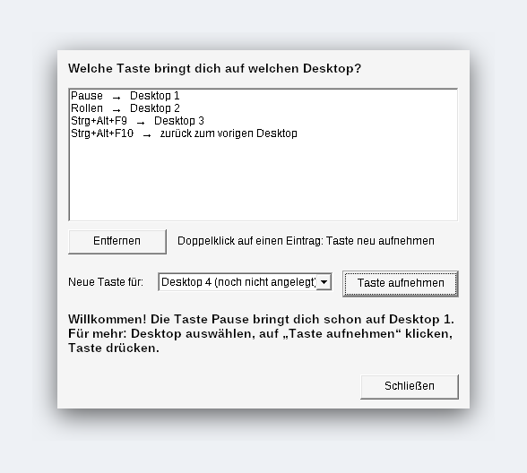

<div align="center">

# 🕶️ Bosskey

### Eine Taste, und du bist sofort auf einem anderen Desktop.

**Kleines Tray-Programm für Windows 10 und 11: per Tastendruck auf einen virtuellen Desktop deiner Wahl springen, ohne dass man den Wechsel sieht.**
Kein Netzwerk. Keine Adminrechte. Eine EXE.

[](#benutzung)
[](#selbst-bauen)
[](#lizenz)
[](https://ko-fi.com/burnersen)

**[⬇️ Neuestes Release herunterladen](https://github.com/burnersen/Bosskey/releases/latest)** · **[☕ Spendier mir einen Kaffee](https://ko-fi.com/burnersen)**



<sub>Das Fenster „Tasten einrichten“ (Aufnahme unter Wine, unter Windows übernimmt es das Aussehen deines Systems).</sub>

</div>

> 💜 **Nutzt du Bosskey und es gefällt dir?** Ein ⭐ auf GitHub ist die einfachste Art, mir das zu sagen, und es bringt mehr, als man denkt: Sterne sind der sichtbare Beweis, dass ein Projekt gute Arbeit leistet, und darüber finden andere kleine Projekte wie dieses überhaupt erst Leute. Oder [erzähl mir, wofür du es nutzt](https://github.com/burnersen/Bosskey/issues/new), ich lese jede Nachricht. Danke, dass du da bist!

---

Ein kleines Programm für den Infobereich der Taskleiste: per Tastendruck auf einen virtuellen Desktop deiner Wahl. Gedacht als Boss-Taste: eine Taste, und du bist sofort auf Desktop 1, ohne dass man den Wechsel sieht. Mit mehreren Tasten springst du auf mehrere Desktops. Eingerichtet wird per Klick und Tastendruck, ohne Textdatei.

Nur für Windows 10 und 11 (x64 und ARM64).

## Die wichtigsten Zusicherungen

- **Kein Netzwerk.** Bosskey arbeitet nur lokal, es ruft nirgends an und lädt nichts nach.
- **Keine Adminrechte.** Alles läuft als normaler Nutzer, auch der Autostart und das Abschalten der Animationen.
- **Was Bosskey an Windows ändert, nimmt es auch wieder zurück.** Die Animationen stellt der Haken „Desktop-Wechsel ohne Animation“ genau so wieder her, wie sie vorher waren.
- **Deine Einstellungsdatei gehört dir.** Bosskey liest `Bosskey.ini`, legt sie an, wenn sie fehlt, und hängt neue Einstellungen höchstens ans Ende an (vorher mit Sicherung als `.bak`). Deine Zeilen ändert es nie.
- **Es wird nichts gelöscht.** Bosskey drückt nur Strg+Win+Pfeil für dich, so wie du es auch selbst könntest.

## Benutzung

1. `Bosskey.exe` irgendwo hinlegen und doppelklicken. Unten rechts im Infobereich erscheint das Symbol (eventuell hinter dem kleinen Pfeil ^), und beim ersten Start geht gleich das Fenster **Tasten einrichten** auf.
2. Ab Werk springt die Taste **Pause** auf Desktop 1.
3. Weitere Tasten: im Fenster den Desktop auswählen, auf **Taste aufnehmen** klicken und die Taste oder Kombination drücken. Fertig, gespeichert, gilt sofort.
4. Das Fenster kommt jederzeit wieder mit einem **Linksklick aufs Symbol**.
5. Rechtsklick > **Mit Windows starten** setzt den Haken für den Autostart.

### Das Fenster „Tasten einrichten“

- **Taste aufnehmen:** Desktop wählen, klicken, Taste drücken. Esc bricht ab, nach 15 Sekunden ohne Taste auch. Während der Aufnahme kommt die Taste in keinem anderen Programm an, auch Kombinationen mit Win nicht.
- **Neu aufnehmen:** Doppelklick auf einen Eintrag in der Liste.
- **Entfernen:** Eintrag anklicken, „Entfernen“.
- Ist eine Taste schon von Windows oder einem anderen Programm belegt, sagt Bosskey das sofort. Hängt sie schon an einem anderen Desktop, fragt es, ob sie umziehen soll. Bei Tasten, die du zum Schreiben brauchst (Buchstaben, Ziffern, Leertaste ohne Strg, Alt oder Win), fragt es nach.
- Als Ziel geht auch **Zurück zum vorigen Desktop**: springt dorthin, wo du vor dem letzten Sprung von Bosskey warst.
- **Gute Boss-Tasten** sind welche, die du sonst nie brauchst: Pause, Rollen, die Menü-Taste neben der rechten Strg-Taste.

### Das Menü am Symbol (Rechtsklick)

| Eintrag | Was er tut |
|---|---|
| Tasten einrichten ... | das Fenster von oben (dasselbe wie Linksklick) |
| Zu Desktop 1 ... | springt dorthin, rechts steht die Taste dafür |
| Desktop-Wechsel ohne Animation | Haken an: Windows-Animationen aus. Haken raus: wieder wie vorher |
| Weitere Einstellungen (INI) | öffnet `Bosskey.ini` im Editor |
| Einstellungen neu laden | liest alles sofort neu (passiert sonst von selbst nach dem Speichern) |
| Protokoll öffnen | öffnet das Log, falls etwas nicht klappt |
| Mit Windows starten | Autostart an oder aus (für deinen Benutzer, ohne Adminrechte) |
| Beenden | Symbol weg, Tasten wieder frei |

## Desktop-Wechsel ohne Animation

Windows hat keine offizielle Schnittstelle, um direkt auf Desktop X zu springen. Die inoffizielle ändert sich mit fast jedem großen Windows-Update. Bosskey liest deshalb aus der Registry, auf welchem Desktop du bist, und drückt dann so oft Strg+Win+Pfeil, bis du am Ziel bist. Das hält jedes Update aus, zeigt aber normalerweise die Schiebe-Animation über die Desktops dazwischen. Für eine Boss-Taste ist das blöd.

Darum schaltet Bosskey beim Start zwei Animationen von Windows ab und sagt das einmal in einer Meldung:

- **Windows 11:** Einstellungen > Barrierefreiheit > Visuelle Effekte > **Animationseffekte** (in der Systemsteuerung heißt das „Steuerelemente und Elemente innerhalb von Fenstern animieren“)
- **Windows 10:** Systemsteuerung > System > Erweiterte Systemeinstellungen > Leistung > **Animation beim Minimieren und Maximieren von Fenstern**

Das ist rein optisch: Fenster gehen ohne Gleiten auf und zu, sonst ändert sich nichts. Es sind Einstellungen deines Benutzers, Adminrechte braucht es nicht. Was vorher eingestellt war, merkt sich Bosskey. Nimmst du im Menü den Haken bei **Desktop-Wechsel ohne Animation** raus, kommt genau das zurück. Klappt das Abschalten nicht, nennt die Meldung den Weg von Hand.

## Einstellungen in der INI

Die Tasten stehen nicht in der INI, die richtest du im Fenster ein. In `Bosskey.ini` stehen nur noch zwei Kleinigkeiten:

| Einstellung | Standard | Bedeutung |
|---|---|---|
| `meldungBeimStart` | `true` | Beim Start kurz anzeigen, welche Tasten aktiv sind |
| `nochmalZurueck` | `false` | Nochmal drücken, obwohl du schon auf dem Ziel-Desktop bist, springt zurück dorthin, wo du vorher warst. Aus, damit ein doppelter Druck vor dem Chef nicht alles wieder aufdeckt |

**Von Version 0.1.0:** Deine Tasten aus dem Abschnitt `[Tasten]` der INI übernimmt Bosskey beim ersten Start einmal. Danach liest es den Abschnitt nicht mehr, du kannst ihn löschen.

## Wenn etwas nicht klappt

| Meldung | Was tun |
|---|---|
| ... ist schon von Windows oder einem anderen Programm belegt | Eine andere Taste aufnehmen. Viele Win-Kombinationen hat Windows selbst, F12 auch. |
| Desktop 4 gibt es nicht, du hast gerade 3 | Mit Win+Strg+D einen neuen Desktop anlegen oder die Taste auf einen anderen Desktop legen. |
| Der Desktop-Wechsel hat nicht geklappt | Oft liegt ein Programm mit Adminrechten vorne (z. B. der Task-Manager). Einmal auf die Taskleiste klicken und nochmal drücken. |
| Konnte die Windows-Animationen nicht abschalten | Von Hand ausschalten, Weg siehe oben. Springen geht trotzdem, nur mit Animation. |
| Bosskey läuft schon. | Das Symbol ist schon im Infobereich, eventuell hinter dem Pfeil ^. |

## Wo die Dateien liegen

| Was | Ort |
|---|---|
| Einstellungen | `%APPDATA%\Bosskey\Bosskey.ini` |
| Tasten | `%APPDATA%\Bosskey\tasten.json` (schreibt Bosskey, bitte übers Fenster ändern) |
| Animationen vorher | `%APPDATA%\Bosskey\animation.json` |
| Protokoll | `%LOCALAPPDATA%\Bosskey\logs\bosskey.log` |
| Autostart | Registry `HKCU\Software\Microsoft\Windows\CurrentVersion\Run`, Wert `Bosskey` |

Mit einer leeren Datei `portable.txt` neben der exe bleiben Einstellungen, Tasten und Protokoll in diesem Ordner.

## Schalter für die Kommandozeile

Ohne Schalter startet Bosskey im Infobereich. Für Fehlersuche und CI:

| Schalter | Was er tut |
|---|---|
| `-version` | Version zeigen |
| `-pruefen` | Einstellungen und Tasten prüfen und sagen, was gilt; ändert nichts |
| `-debug` | mehr Einzelheiten ins Protokoll |
| `-probelauf` | starten und nach drei Sekunden von selbst beenden (für die CI) |

Exit-Codes: `0` alles erledigt, `1` etwas ging schief (die Meldung sagt, was zu tun ist), `2` falscher Aufruf.

## Selbst bauen

Gebraucht wird Go in der Version aus `go.mod`. Keine weiteren Abhängigkeiten.

```
go test ./...
go vet ./...
GOOS=windows go vet ./...
go build -ldflags "-H windowsgui" -o Bosskey.exe .
```

Selbst gebaut gibt es das Standardsymbol von Windows. Das eigene Symbol bettet der Release-Bau mit go-winres ein.

## ☕ Unterstützen

Bosskey ist kostenlos und entsteht in meiner Freizeit, auf meiner eigenen Hardware und Stromrechnung. Wenn es dir Zeit gespart hat und du Danke sagen möchtest, kannst du [ein kleines Trinkgeld bei Ko-fi dalassen](https://ko-fi.com/burnersen), das hält Motivation und Kaffee am Laufen. ☕ Völlig freiwillig, und in jedem Fall: danke fürs Benutzen!

## Lizenz

GPL-3.0-only, siehe [LICENSE](LICENSE).
